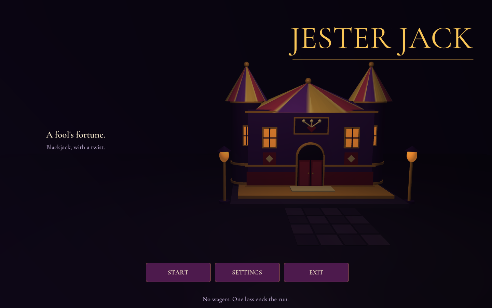
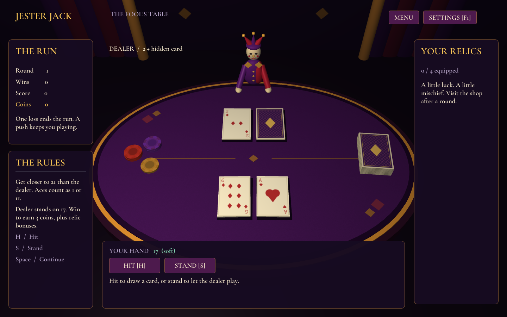
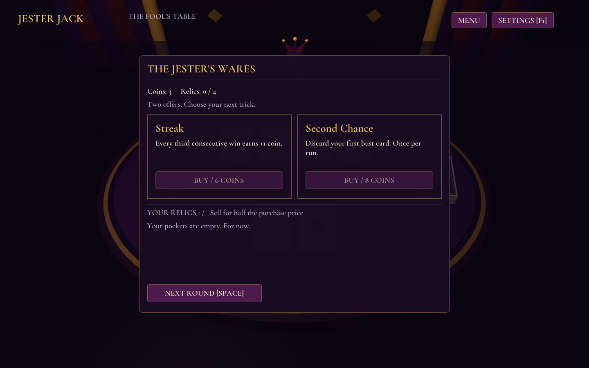

# Final-Project-CGF - Jester Jack

[](https://github.com/F1j1tun1/Final-Project-CGF/actions/workflows/build.yml)

**Jester Jack** - учебный прототип одиночного блэкджека с бесконечными раундами и магазином улучшений. Одна проигранная раздача завершает забег. Ставок нет: победы приносят монеты, за которые можно собрать набор из четырёх улучшений.

Главное меню показывает крупное название справа, обычным порядком букв слева направо, и процедурное здание казино в шутовском стиле на правой стороне фона. Внизу расположены START, SETTINGS и EXIT. START запускает затемнение и появление у стола за 0,9 секунды; первая рука раздаётся отдельно. Фиолетовый, золотой и красный декор, шут-дилер, 3D-стол и карты сочетаются с непиксельным шрифтом Cormorant Garamond. Интерфейс английский, документация русская.





Основной репозиторий команды: [F1j1tun1/Final-Project-CGF](https://github.com/F1j1tun1/Final-Project-CGF). Работайте в его checkout, а дальнейшие изменения оформляйте отдельными ветками и PR: [CONTRIBUTING.md](CONTRIBUTING.md), [TEAM_WORKFLOW.md](docs/TEAM_WORKFLOW.md).

## Техническая основа

Сохранены **C++17, OpenGL 3.3 Core и CMake 3.24+**, собственные GLSL-шейдеры, model/view/projection, матрица нормалей, Blinn-Phong и процедурные текстуры. Готовый движок не используется. 2D-интерфейс ImGui дополняет собственную 3D-сцену. Связь с заданием и лекциями описана в [COURSE_REQUIREMENTS.md](docs/COURSE_REQUIREMENTS.md) и [LECTURE_ALIGNMENT.md](docs/LECTURE_ALIGNMENT.md).

GLFW, GLM, Dear ImGui и GLAD включены в `third_party/`; CMake не скачивает зависимости. Для полной игры отдельно нужны компилятор C++17, CMake 3.24+ и драйвер OpenGL 3.3 Core.

## Сборка и запуск

```text
git clone https://github.com/F1j1tun1/Final-Project-CGF.git
cd Final-Project-CGF
code .
```

На Windows установите Visual Studio 2022/2026 либо Build Tools с компонентами **Desktop development with C++**, MSVC и Windows SDK. VS Code сам по себе не устанавливает компилятор.

```powershell
cmake --preset desktop
cmake --build --preset desktop --parallel
ctest --preset desktop
.\build\desktop\Debug\blackjack_forge.exe
```

Исполняемый файл и CMake target сохраняют имя `blackjack_forge` для совместимости с настройками сборки. Путь выше соответствует генератору Visual Studio; для Ninja программа обычно находится в `build/desktop/` без подпапки `Debug`. Если CMake не видит MSVC, используйте Developer PowerShell из Visual Studio.

На Debian/Ubuntu для X11 нужны системные пакеты:

```bash
sudo apt install build-essential cmake libgl1-mesa-dev libxrandr-dev libxinerama-dev libxcursor-dev libxi-dev
cmake --preset desktop -DGLFW_BUILD_WAYLAND=OFF
cmake --build --preset desktop --parallel
ctest --preset desktop
./build/desktop/blackjack_forge
```

Проверьте `cmake --version`: версия из репозитория дистрибутива может быть ниже 3.24. Если нужен Wayland, установите `libwayland-dev`, `libxkbcommon-dev`, `wayland-protocols` и конфигурируйте без его отключения. Названия пакетов зависят от дистрибутива.

Правила можно собрать без окна, OpenGL и GPU:

```text
cmake --preset core-only
cmake --build --preset core-only --parallel
ctest --preset core-only
```

## Правила и магазин

Наберите сумму ближе к 21, чем дилер. Туз считается как 1 или 11; натуральный блэкджек - 21 на первых двух картах. Дилер останавливается на 17, включая мягкие 17. Поражение заканчивает забег, ничья сохраняет забег и серию, но не приносит награду. Ограничения числа раундов и финальной победы нет.

За победу начисляются **3 монеты** плюс небольшие бонусы улучшений. Очки - сумма победной руки, +10 за натуральный блэкджек и возможные бонусы улучшений; они показывают результат забега и не открывают этапы. Перед каждой раздачей равномерно перемешивается новая колода из 52 карт без подыгрывания блэкджеку. При случайной обычной раздаче шанс натурального блэкджека составляет около 4,83%.

После победы или ничьей открывается магазин: **два случайных предложения из 12 улучшений**, цены 2/4/6/8 монет. Предложения фиксируются на весь визит и по возможности отличаются от предыдущего магазина. Уже активное улучшение не предлагается и не может дублироваться. Одновременно можно держать максимум **четыре** улучшения; покупать оба предложения необязательно. Продажа доступна в магазине за половину цены покупки. Проданное улучшение может появиться в следующих магазинах; покупка и продажа не меняют текущую пару предложений. Полный каталог и точные эффекты - в [ARCHITECTURE.md](docs/ARCHITECTURE.md).



Обычный запуск получает новый случайный seed. `--seed N` воспроизводит тот же забег при тех же действиях; карты и магазин используют отдельные генераторы. На экране проигрыша показан seed. Повторный NEW RUN при фиксированном seed увеличивает его на 1; чтобы воспроизвести прежний забег, запустите программу снова с исходным `--seed`.

| Клавиша | Действие |
| --- | --- |
| H | Взять карту |
| S | Остановиться |
| Space | START / раздать / продолжить / следующий раунд / новый забег |
| F1 | Открыть или закрыть настройки |
| Escape | Закрыть настройки, иначе вернуться в меню |

Выход из приложения - EXIT в главном меню. START из меню начинает новый забег. Настройки включают камеру, свет, текстуры, фоновое движение и стартовый переход. Во время перехода и открытых настроек игровые команды блокируются.

## Демо и проверка графики

Примеры для Windows; на Linux замените путь программы на `./build/desktop/blackjack_forge`.

```powershell
# Пропустить меню и сразу раздать руку для воспроизводимой проверки.
.\build\desktop\Debug\blackjack_forge.exe --demo --seed 42

# Сохранить главный экран или стол.
.\build\desktop\Debug\blackjack_forge.exe --hidden --frames 3 --screenshot build/menu.png
.\build\desktop\Debug\blackjack_forge.exe --hidden --demo --seed 42 --frames 3 --screenshot build/table.png

# Интеграция: меню, переход, игровые команды, изменение размера окна.
.\build\desktop\Debug\blackjack_forge.exe --smoke --frames 600 --capture-states build/captures
```

`--smoke` использует seed 42, если явно не задан другой, скрытое окно и автоматические действия; по умолчанию длится 180 кадров. `--autoplay` включает автоматические действия отдельно, `--no-animation` пропускает стартовый переход, `--help` показывает параметры. `--capture-states DIR` сохраняет встреченные состояния, поэтому для магазина и проигрыша нужен достаточно длинный прогон.

Даже скрытому окну нужен рабочий OpenGL-контекст. Smoke проверяет интеграцию и ошибки OpenGL, а визуальная проверка отдельно подтверждает компоновку, читаемость и отрисовку. Исторические результаты прототипа и фактические результаты новой версии записываются раздельно в [VERIFICATION.md](docs/VERIFICATION.md); прежние проверки не подтверждают новую механику и оформление. macOS и машина TA требуют отдельной проверки.

При сборке вся папка `assets/`, включая шрифты и их лицензию, копируется рядом с executable. Ресурсы ищутся рядом с программой, затем в рабочей папке. `--assets DIR` задаёт другой корень с `shaders/` и `fonts/`. При переносе сборки сохраняйте прилегающую `assets/`.

## Структура и продолжение

| Папка | Назначение |
| --- | --- |
| `src/game/` | Чистые правила, детерминированная случайность, забег и магазин |
| `src/graphics/` | OpenGL-ресурсы, геометрия, камера, свет и отрисовка |
| `src/main.cpp` | Окно, меню, ввод, UI, переход и преобразование Snapshot в Scene |
| `assets/` | GLSL-шейдеры и лицензированные шрифты |
| `tests/` | Проверки правил, guards, магазина и воспроизводимости |
| `docs/` | Архитектура, передача проекта, план и результаты проверки |

Контекст для VS Code - [HANDOFF_VSCODE.md](docs/HANDOFF_VSCODE.md). Дальнейшие задачи - [ROADMAP.md](docs/ROADMAP.md): анимации раздачи/переворота, будущие кастомные звуки и саундтреки, баланс и материалы сдачи. Сейчас есть стартовое затемнение и фоновое движение; событийная анимация карт и звук ещё не реализованы. Отчёт, слайды, сохранение и сеть также не объявляются готовыми.

Лицензии библиотек находятся в `third_party/`; Cormorant Garamond распространяется под [SIL OFL 1.1](assets/fonts/OFL-CormorantGaramond.txt). Источники и контрольные суммы - [THIRD_PARTY_NOTICES.md](THIRD_PARTY_NOTICES.md) и [assets/fonts/README.md](assets/fonts/README.md). Изображения и модели казино, шута и карт создаются процедурно; материалы Balatro не включены.
