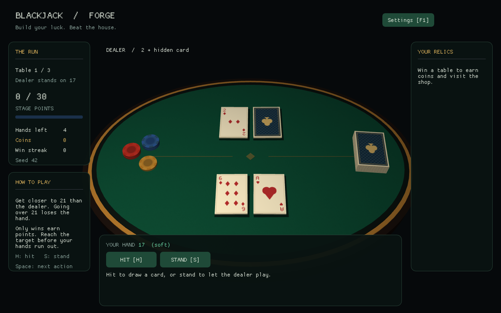

# Final-Project-CGF — Blackjack Forge

[](https://github.com/F1j1tun1/Final-Project-CGF/actions/workflows/build.yml)

Стартовый прототип одиночного блэкджека с короткими забегами и улучшениями в духе Balatro. Стол, карты и фишки — 3D-объекты; счёт, кнопки и магазин — 2D-интерфейс поверх сцены. Это основа учебного проекта, которую команда может развивать в VS Code.

Основной репозиторий команды: [F1j1tun1/Final-Project-CGF](https://github.com/F1j1tun1/Final-Project-CGF). Исходники игры лежат прямо в корне репозитория. Для дальнейших правок работайте в этой копии, а не в ранее выданном архиве прототипа.



## Начало работы с командой

```text
git clone https://github.com/F1j1tun1/Final-Project-CGF.git
cd Final-Project-CGF
code .
```

После установки инструментов выполните команды сборки ниже. Новые изменения делайте в отдельной ветке и отправляйте через Pull Request: пошагово описано в [CONTRIBUTING.md](CONTRIBUTING.md) и [TEAM_WORKFLOW.md](docs/TEAM_WORKFLOW.md). Логи сборки и тестов доступны во вкладке [Actions](https://github.com/F1j1tun1/Final-Project-CGF/actions); успешные Windows-задачи прикладывают архив собранной игры.

На скриншоте задания требуется OpenGL с современным шейдерным конвейером; конкретный язык не указан. Здесь выбран **C++17 + OpenGL 3.3 Core**. В проекте собственный рендерер: model/view/projection, корректное преобразование нормалей, Blinn–Phong и процедурные текстуры. Готовый игровой движок не используется.

## Что уже реализовано

- Блэкджек: «взять» / «остановиться», тузы 1/11, натуральный блэкджек, перебор и ход дилера.
- Забег из трёх этапов с целями 30/65/100 очков и максимум пятью раздачами на этап.
- Магазин с четырьмя улучшениями: Precision, Long Hand, Second Chance и Streak.
- 3D-сцена, 2D HUD, настройки камеры, света, текстур и фонового движения объектов.
- Воспроизводимые забеги по seed, режим демо, сохранение PNG и графический smoke-прогон.
- Тесты правил без окна и GPU; исходники библиотек включены в `third_party/`.

Интерфейс пока на английском: используется встроенный шрифт ImGui. Документация команды — на русском.

## Требования

Для полной игры нужны CMake **3.24+**, компилятор C++17 и видеодрайвер с поддержкой OpenGL 3.3 Core. GLFW, GLM, Dear ImGui и загрузчик GLAD поставляются в исходниках; CMake не скачивает зависимости. Компилятор, SDK и системные графические библиотеки устанавливаются отдельно.

### Windows

Установить Visual Studio 2022/2026 либо соответствующие Build Tools с компонентами **Desktop development with C++**, MSVC и Windows SDK. VS Code — редактор; сам по себе он не устанавливает компилятор.

Открыть терминал в папке с `CMakeLists.txt` и выполнить:

```powershell
cmake --preset desktop
cmake --build --preset desktop --parallel
ctest --preset desktop
.\build\desktop\Debug\blackjack_forge.exe
```

Путь выше соответствует генератору Visual Studio. При использовании Ninja исполняемый файл обычно лежит в `build/desktop/` без подпапки `Debug`. Если CMake не видит MSVC, повторить команды в Developer PowerShell из установленной Visual Studio.

### Linux

Пример системных пакетов для Debian/Ubuntu при сборке с X11:

```bash
sudo apt install build-essential cmake libgl1-mesa-dev libxrandr-dev libxinerama-dev libxcursor-dev libxi-dev
cmake --preset desktop -DGLFW_BUILD_WAYLAND=OFF
cmake --build --preset desktop --parallel
ctest --preset desktop
./build/desktop/blackjack_forge
```

Проверьте `cmake --version`: в репозитории дистрибутива может быть версия ниже 3.24. В GLFW по умолчанию включены X11 и Wayland; если нужен также Wayland, установите `libwayland-dev`, `libxkbcommon-dev`, `wayland-protocols` и конфигурируйте без отключения Wayland. Команды пакетов приведены для Debian/Ubuntu; названия в других дистрибутивах отличаются.

### Только правила, без графических зависимостей

Этот вариант требует только компилятора C++17 и CMake; окно, драйвер OpenGL и библиотеки X11/Wayland для него не нужны.

```text
cmake --preset core-only
cmake --build --preset core-only --parallel
ctest --preset core-only
```

## Как играть

Побеждайте дилера и наберите цель этапа до окончания пяти раздач. Победа приносит сумму руки с бонусами; проигрыш и ничья дают ноль. Натуральный блэкджек — 21 на первых двух картах — добавляет 10 очков. Дилер останавливается на 17, включая мягкие 17; на финальном этапе его порог — 18.

После выполнения цели нажмите Continue: за этап начисляется 5 монет и открывается магазин. Каждое улучшение стоит 3 монеты, повторная покупка запрещена. После двух магазинов начнётся финальный этап. Подробные правила эффектов и порядок множителей описаны в [архитектуре](docs/ARCHITECTURE.md).

| Клавиша | Действие |
| --- | --- |
| H | Взять карту |
| S | Остановиться |
| Space | Основное действие текущего экрана: раздать, продолжить, выйти из магазина или начать новый забег |
| F1 | Открыть/закрыть настройки графики |
| Escape | Закрыть игру |

Все действия доступны также кнопками мыши. Новая игра через экран результата увеличивает seed на 1; для точного повтора используйте параметр запуска `--seed`.

## Демо и проверка графики

Примеры для Windows; на Linux замените путь к программе на `./build/desktop/blackjack_forge`.

```powershell
# Сразу раздать первую руку с заданным seed.
.\build\desktop\Debug\blackjack_forge.exe --demo --seed 42

# Сохранить финальный кадр трёхкадрового прогона в PNG.
.\build\desktop\Debug\blackjack_forge.exe --hidden --demo --frames 3 --screenshot preview.png

# 180 кадров со скрытым окном, автоматическими действиями и проверкой ошибок OpenGL.
.\build\desktop\Debug\blackjack_forge.exe --smoke
```

`--hidden` скрывает окно, но всё равно требует рабочую графическую сессию и OpenGL-контекст. Smoke-прогон проверяет интеграцию и ошибки OpenGL, однако не заменяет визуальную проверку и прохождение игры человеком. `--frames N` завершает приложение после N кадров; `--autoplay` включает автоматические действия; `--help` показывает параметры.

При сборке `assets/` копируется рядом с исполняемым файлом. Приложение ищет ресурсы рядом с программой, затем в рабочей папке. Параметр `--assets <папка>` задаёт другой корень ресурсов, содержащий `shaders/`. При переносе собранной игры сохраняйте `assets/` рядом с ней.

## Структура и продолжение

| Файл/папка | Назначение |
| --- | --- |
| `src/game/` | Чистая игровая логика и состояние забега |
| `src/graphics/` | OpenGL-ресурсы, сцена, камера и отрисовка |
| `src/main.cpp` | Окно, UI, главный цикл и связь модулей |
| `assets/shaders/` | GLSL-шейдеры |
| `tests/` | Проверки правил и воспроизводимых забегов |
| `.vscode/` | Задачи сборки, запуск и настройки CMake Tools |

Начните с [архитектуры](docs/ARCHITECTURE.md), [соответствия заданию](docs/COURSE_REQUIREMENTS.md) и [плана работы](docs/ROADMAP.md). Инструкция для перехода в VS Code и готовый запрос для Codex находятся в [HANDOFF_VSCODE.md](docs/HANDOFF_VSCODE.md). Правила изменения кода — в [AGENTS.md](AGENTS.md).

Дальше нужны анимация раздачи и переворота, звук, больше контента, проверка баланса и проверка на машине преподавателя. Сохранения, сеть, финальный отчёт и слайды пока не реализованы. При текущей экономике за один забег можно купить максимум три из четырёх улучшений.

## Статус проверки

Локально проверены Windows/MSVC, 3 000 воспроизводимых забегов (1 147 808 проверок, 0 ошибок) и 600 кадров на Intel OpenGL 3.3. После переноса 16 октября 2026 [GitHub Actions](https://github.com/F1j1tun1/Final-Project-CGF/actions/runs/38881054596) успешно выполнил сборку и CTest в Windows/Ubuntu × Debug/Release, а также графический smoke через Mesa/Xvfb на Ubuntu. В этом запуске доступны Windows-артефакты. Подробности и ограничения — в [VERIFICATION.md](docs/VERIFICATION.md). macOS, ручная проверка Linux на другой видеокарте и машина TA ещё не проверены.

## Библиотеки и лицензии

Сохраняйте лицензии внутри `third_party/`: [GLFW](third_party/glfw/LICENSE.md), [Dear ImGui](third_party/imgui/LICENSE.txt), лицензия GLM в его исходниках и сведения о GLAD в сгенерированном заголовке. Исходный архив должен включать `third_party/` целиком. Для новых изображений, музыки и моделей также фиксируйте автора и разрешение на использование.
