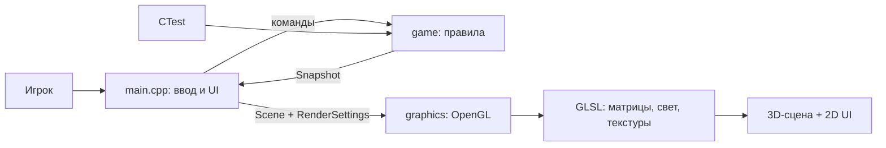
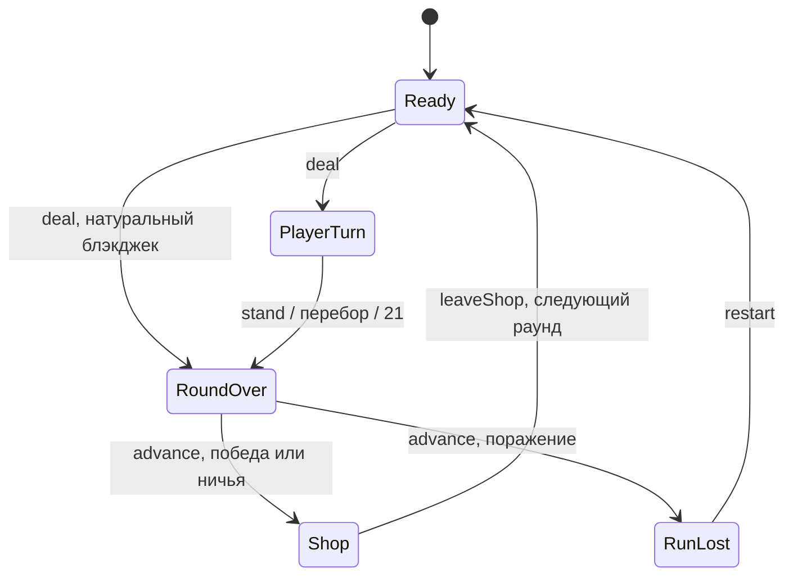

# Архитектура Jester Jack

Jester Jack - учебный C++17/OpenGL 3.3 Core прототип блэкджека. Бесконечные раунды продолжаются до первой проигранной раздачи; победа даёт монеты, магазин помогает собрать набор улучшений. Ставок, целей этапов и финальной победы нет. Вдохновение Balatro относится к циклу «раздача - награда - магазин», собственные код, геометрия и оформление самостоятельны.

## Стек и границы

| Часть | Технология | Ответственность |
| --- | --- | --- |
| Приложение | C++17, GLFW 3.4, Dear ImGui 1.91.9b | Окно, ввод, меню, UI, время кадра и переход |
| Правила | Чистый C++17 | Колода, исходы, награды, забег, покупки и продажи |
| Графика | OpenGL 3.3 Core, GLAD, GLM 1.0.1 | Меши, текстуры, шейдеры, камера и освещение |
| Сборка и тесты | CMake 3.24+, CTest | Пресеты desktop/core-only, тесты правил без GPU |

Зависимости vendored в `third_party/`; сборка не скачивает библиотеки. Совместимое имя CMake target и executable остаётся `blackjack_forge`.

- `src/game/` не зависит от GLFW, ImGui, OpenGL, файлов, часов и анимаций. `Game` принимает команды и отдаёт `const Snapshot&`. Заблокированные команды возвращают `false` без изменения состояния или генераторов случайности.
- `src/graphics/` получает визуальную сцену и настройки. Здесь находятся меши, текстуры, камера, свет, казино, интерьер и шут; рендерер не определяет исходы и награды.
- `src/main.cpp` связывает окно, команды, меню, UI и `Snapshot -> Scene`. `Session` хранит экран меню и стартовый переход, `Commands` допускает не более одной принятой игровой команды за кадр. Небольшой модуль представления можно выделить при необходимости, без смены архитектуры.

## Состояния игры

`Card` хранит ранг и масть, `evaluateHand()` - сумму, мягкую руку, блэкджек и перебор. Туз считается как 11, пока это не приводит к перебору, иначе как 1. Натуральный блэкджек - сумма 21 на первых двух картах. Дилер останавливается на 17, включая мягкие 17; натуральный блэкджек сильнее обычной суммы 21.

`Snapshot` содержит руки, фазу, исход, номер раунда, число побед, общий счёт, монеты, серию, seed, активные улучшения, предложения магазина и последнюю награду. Позиции объектов и время перехода в него не входят.

Команды `deal`, `hit`, `stand`, `advance`, `buy`, `sell`, `leaveShop` проверяют фазу и допустимость действия; `restart(seed)` сбрасывает забег. Результат сначала виден в `RoundOver`; после поражения продолжение ведёт только к `RunLost`. Победа и ничья открывают магазин, из которого можно выйти без покупки. Выход из магазина увеличивает номер раунда и очищает руки. Число раундов не ограничено игровым правилом.

Перед каждой раздачей создаётся новая колода из 52 разных карт и равномерно перемешивается Fisher-Yates с rejection sampling. Подыгрывания, удаления блэкджеков и смены вероятностей нет. Вероятность натурального блэкджека обычной начальной руки: `2 * 4 * 16 / (52 * 51)`, около 4,83%.

`cardRandom_` и `shopRandom_` - отдельные `std::mt19937`, инициируемые seed и `seed ^ 0x9e3779b9`. Выбор предложений магазина не сдвигает генератор карт. Одинаковый seed и одинаковые команды дают одинаковую игру независимо от кадров, анимаций и UI. Обычный запуск выбирает seed через `std::random_device` в приложении; `--seed` фиксирует его, `--smoke` по умолчанию использует 42.

## Награды и улучшения

За победу начисляются **3 монеты** и условные бонусы активных улучшений. Очки равны сумме руки, +10 за натуральный блэкджек и бонусам очков. Очки служат результатом забега; порогов прохождения нет. Ничья даёт ноль монет и очков, сохраняет серию. Поражение даёт ноль и обрывает забег. Бонусы монет складываются и срабатывают только при победе.

| Улучшение | Цена | Эффект |
| --- | --- | --- |
| Precision | 6 | +1 монета за победу с 21 |
| Long Hand | 6 | +1 монета за победу с 4 и более картами |
| Second Chance | 8 | Отменяет первую взятую карту перебора один раз за забег |
| Streak | 6 | +1 монета за каждую третью победу серии; ничья серию сохраняет |
| Royal Purse | 2 | +1 монета за победу с натуральным блэкджеком |
| Soft Touch | 2 | +1 монета за победу с мягкой рукой |
| Narrow Escape | 4 | +1 монета за победу при переборе дилера |
| Red Ribbon | 4 | +1 монета за победу, если две начальные карты игрока красные |
| Black Velvet | 4 | +1 монета за победу, если две начальные карты игрока чёрные |
| Even Odds | 4 | +1 монета за победу с чётной суммой руки |
| Court Favor | 2 | +3 очка за победу с хотя бы одним J, Q или K |
| Humble Crown | 2 | +5 очков за победу с суммой не больше 18 |

Second Chance не возвращает отменённую карту в колоду; игрок продолжает ход. Использованный заряд не восстанавливается при продаже и повторной покупке, обновляется только при `restart`.

При открытии магазина выбираются две разные случайные позиции из неактивных улучшений. Предложения предыдущего визита исключаются, если хватает других кандидатов; пара сохраняется до выхода из магазина, покупки и продажи её не перерисовывают. Максимум **4 активных улучшения**, дубликаты запрещены, покупка требует достаточно монет. Можно купить одно, оба или ни одного предложения. Один и тот же предмет нельзя купить повторно в том же визите после продажи. Продажа возвращает половину неизменной цены; проданное улучшение снова доступно пулу следующих магазинов.

## Меню и презентация

Главное меню - отдельная визуальная сцена с казино справа, башенками, полосатыми крышами и тёплыми окнами. Крупное `JESTER JACK` расположено справа, читается слева направо. Снизу START, SETTINGS, EXIT. Игровая сцена показывает стол, карты, фишки, шутовской интерьер и процедурного шута-дилера. Основная палитра - фиолетовая, золотая и красная. Английский UI использует лицензированный Cormorant Garamond из `assets/fonts/`.

START начинает новый забег: затемнение до чёрного, смена меню на стол в середине перехода, проявление стола. Общая длительность 0,9 секунды; итоговая фаза `Ready`, без автоматической раздачи. Повторное нажатие и игровые команды во время перехода блокируются. START из меню сбрасывает текущий забег; NEW RUN после проигрыша делает то же. При фиксированном seed следующие забеги получают `seed + 1`; при обычном запуске новый seed выбирается заново. `--demo` отдельно пропускает меню и сразу раздаёт первую руку.

SETTINGS сохраняет управление светом, текстурами, фоновым движением и камерой; добавлен переключатель стартового перехода. `--no-animation` отключает переход. Escape закрывает настройки либо возвращает в меню; EXIT закрывает приложение. Пока открыты настройки, игровые команды заблокированы.

Вторая карта дилера визуально закрыта только в `PlayerTurn`. Стартовое затемнение и фоновое движение реализованы; событийная анимация раздачи/переворота и звук пока планируются. Будущие кастомные звуки и саундтреки не должны влиять на правила.

## Графический конвейер и ресурсы

1. GLFW собирает события; приложение формирует UI и передаёт допустимые команды в `Game`.
2. `Snapshot` преобразуется в `gfx::Scene`; `Scene::menu` выбирает казино или стол, `time` нужен только для визуального движения. `RenderSettings` задаёт свет, текстуры и камеру.
3. Рендерер обновляет viewport, очищает цвет/глубину, включает depth test и рисует процедурные меши.
4. Vertex shader вычисляет `projection * view * model * position`; нормали преобразуются `transpose(inverse(mat3(model)))`.
5. Fragment shader сочетает UV-выборку `GL_TEXTURE_2D` с ambient/diffuse/specular Blinn-Phong.
6. ImGui рисует интерфейс и затемнение поверх сцены, GLFW показывает кадр.

Процедурные изображения карт формируются на CPU и загружаются в GPU. Ресурсы OpenGL принадлежат RAII-объектам и уничтожаются до окна/контекста. Шрифты, шейдеры и лицензия шрифта копируются в прилегающую `assets/`; поиск ресурсов не требует запуска из корня репозитория.

## Проверка и развитие

Тесты правил покрывают руки, дилера, исходы, награды, все улучшения, ограничения магазина, бесконечный цикл, проигрыш, guards и seed. Графическая проверка отдельно подтверждает меню, переход, стол, магазин, проигрыш, настройки и изменение окна. Команды и фактические результаты фиксируются в [VERIFICATION.md](VERIFICATION.md); исторические проверки старого прототипа не относятся автоматически к этой версии.

Следующие задачи выбираются по запросу команды: событийные анимации карт, лицензированные кастомные звуки/музыка, измерение баланса, материалы сдачи и проверка на другой машине. Обязательные техники курса и источники лекций - в [COURSE_REQUIREMENTS.md](COURSE_REQUIREMENTS.md) и [LECTURE_ALIGNMENT.md](LECTURE_ALIGNMENT.md).
