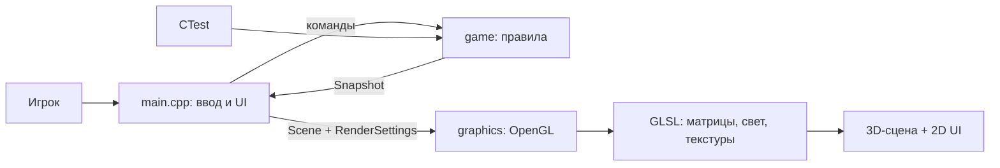
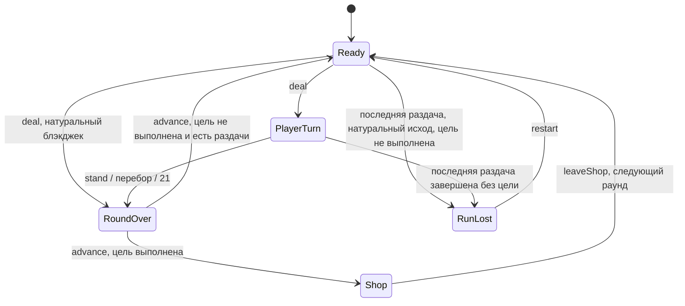

# Архитектура Jester Jack

Jester Jack - учебный C++17/OpenGL 3.3 Core прототип блэкджека. Каждый раунд даёт до пяти раздач для набора цели; выполнение цели открывает магазин и следующий раунд. Раунды бесконечны, забег заканчивается при исчерпании раздач без выполнения цели. Победные руки дают монеты для улучшений. Ставок и финальной победы нет. Вдохновение Balatro относится к циклу «раздачи - цель - магазин» и компоновке HUD; собственные код, геометрия и ресурсы самостоятельны.

## Стек и границы

| Часть | Технология | Ответственность |
| --- | --- | --- |
| Приложение | C++17, GLFW 3.4, Dear ImGui 1.91.9b | Окно, ввод, меню, UI, время кадра и переход |
| Правила | Чистый C++17 | Колода, исходы, награды, забег, покупки и продажи |
| Графика | OpenGL 3.3 Core, GLAD, GLM 1.0.1 | Меши, текстуры, шейдеры, камера и освещение |
| Сборка и тесты | CMake 3.24+, CTest | Пресеты desktop/core-only, тесты правил без GPU |

Зависимости vendored в `third_party/`; сборка не скачивает библиотеки. Совместимое имя CMake target и executable остаётся `blackjack_forge`.

- `src/game/` не зависит от GLFW, ImGui, OpenGL, файлов, часов и анимаций. `Game` принимает команды и отдаёт `const Snapshot&`. Заблокированные команды возвращают `false` без изменения состояния или генераторов случайности.
- `src/graphics/` получает визуальную сцену и настройки. Здесь находятся меши, текстуры, камера, свет, казино и интерьер; рендерер не определяет исходы и награды.
- `src/main.cpp` связывает окно, команды, меню, UI и `Snapshot -> Scene`. `Session` хранит экран меню и стартовый переход, `Commands` допускает не более одной принятой игровой команды за кадр. Небольшой модуль представления можно выделить при необходимости, без смены архитектуры.

## Состояния игры

`Card` хранит ранг и масть, `evaluateHand()` - сумму, мягкую руку, блэкджек и перебор. Туз считается как 11, пока это не приводит к перебору, иначе как 1. Натуральный блэкджек - сумма 21 на первых двух картах. Дилер останавливается на 17, включая мягкие 17; натуральный блэкджек сильнее обычной суммы 21.

`Snapshot` содержит руки, фазу, исход, номер и цель раунда, оставшиеся раздачи, счёт раунда, число побед, общий счёт, монеты, серию, seed, активные улучшения, предложения магазина и последнюю награду. Позиции объектов и время перехода в него не входят. Раздача - одна рука против дилера; раунд объединяет до пяти раздач и имеет общую цель.

Команды `deal`, `hit`, `stand`, `advance`, `buy`, `sell`, `leaveShop` проверяют фазу и допустимость действия; `restart(seed)` сбрасывает забег. Обычно результат раздачи виден в `RoundOver`. Если завершена пятая раздача, а цель не выполнена, `finishRound` сразу устанавливает `RunLost`: экран GAME OVER появляется автоматически, без дополнительного Continue. Выполненная цель имеет приоритет даже на последней раздаче; продолжение из `RoundOver` ведёт в магазин. Проигрыш одной руки сам по себе не заканчивает забег. Магазин открывается только после цели; выйти можно без покупки.

В каждом раунде пять раздач; счётчик уменьшается при `deal`. Цель первого раунда 30 очков, затем +10 за раунд с пределом 100: `min(30 + 10 * (round - 1), 100)`. С восьмого раунда цель остаётся 100. При выполнении цели на последней раздаче открывается магазин, а не проигрыш. `leaveShop` увеличивает номер раунда, задаёт новую цель, обнуляет счёт раунда, возвращает пять раздач и очищает руки; монеты, общий счёт, активные улучшения и серия сохраняются. Финальной победы и ограничения числа раундов нет.

Перед каждой раздачей создаётся новая колода из 52 разных карт и равномерно перемешивается Fisher-Yates с rejection sampling. Подыгрывания, удаления блэкджеков и смены вероятностей нет. Вероятность натурального блэкджека обычной начальной руки: `2 * 4 * 16 / (52 * 51)`, около 4,83%.

`cardRandom_` и `shopRandom_` - отдельные `std::mt19937`, инициируемые seed и `seed ^ 0x9e3779b9`. Выбор предложений магазина не сдвигает генератор карт. Одинаковый seed и одинаковые команды дают одинаковую игру независимо от кадров, анимаций и UI. Обычный запуск выбирает seed через `std::random_device` в приложении; `--seed` фиксирует его, `--smoke` по умолчанию использует 42.

## Награды и улучшения

За победную руку начисляются **3 монеты** и условные бонусы активных улучшений. База очков равна сумме руки; к ней добавляются +10 за натуральный блэкджек и бонусы улучшений. Streak умножает эту сумму на `1 + 0.1 * min(число предшествующих побед серии, 4)`; итог округляется до ближайшего целого и добавляется к счёту раунда и общему результату забега. Без Streak множитель равен 1. Ничья даёт ноль монет и очков, сохраняет серию. Проигрыш руки даёт ноль и обрывает серию, но забег продолжается, пока остаются раздачи для выполнения цели. Бонусы монет складываются, не умножаются и срабатывают только при победе.

| Улучшение | Редкость | Цена | Эффект |
| --- | --- | --- | --- |
| Precision | Rare | 6 | +5 очков и +1 монета за победу с 21 |
| Long Hand | Rare | 6 | +8 очков и +1 монета за победу с 4 и более картами |
| Second Chance | Legendary | 10 | Отменяет первую взятую карту перебора один раз за раунд |
| Streak | Epic | 8 | +0,1 к множителю очков за предшествующую победу серии, максимум x1,4; +1 монета за каждую третью победу серии |
| Royal Purse | Common | 2 | +1 монета за победу с натуральным блэкджеком |
| Soft Touch | Common | 2 | +1 монета за победу с мягкой рукой |
| Narrow Escape | Rare | 6 | +3 очка и +1 монета за победу при переборе дилера |
| Red Ribbon | Uncommon | 4 | +1 монета за победу, если две начальные карты игрока красные |
| Black Velvet | Uncommon | 4 | +1 монета за победу, если две начальные карты игрока чёрные |
| Even Odds | Uncommon | 4 | +1 монета за победу с чётной суммой руки |
| Court Favor | Common | 2 | +3 очка за победу с хотя бы одним J, Q или K |
| Humble Crown | Common | 2 | +5 очков за победу с суммой не больше 18 |

Second Chance не возвращает отменённую карту в колоду; игрок продолжает ход. Использованный заряд не восстанавливается при продаже и повторной покупке. Заряд обновляется в начале следующего раунда и при `restart`.

При открытии магазина выбираются две разные позиции из неактивных улучшений. Для каждой позиции сначала выбирается доступная редкость по весу, затем равномерно предмет внутри неё:

| Редкость | Базовый вес |
| --- | --- |
| Common | 50 |
| Uncommon | 28 |
| Rare | 14 |
| Epic | 6 |
| Legendary | 2 |

Активные предметы и уже выбранная позиция исключаются. Если в редкости нет доступных предметов, её вес убирается, остальные условно нормируются по оставшейся сумме. В выбранной редкости предпочтение отдаётся предметам, которых не было в предыдущем магазине; если свежих нет, допускается прошлое предложение той же редкости. Поэтому предпочтение новым предметам не уничтожает шанс одиночных Epic и Legendary, а второй слот может иметь другие условные вероятности. Веса не задают принудительные проценты за отдельный забег.

Пара сохраняется до выхода из магазина, покупки и продажи её не перерисовывают. Максимум **4 активных улучшения**, дубликаты запрещены, покупка требует достаточно монет. Можно купить одно, оба или ни одного предложения. Один и тот же предмет нельзя купить повторно в том же визите после продажи. Продажа возвращает половину неизменной цены; проданное улучшение снова доступно пулу следующих магазинов.

## Меню и презентация

Главное меню - отдельная визуальная сцена: увеличенное `Jester Jack` вверху слева, ниже три крупные вертикальные кнопки START, OPTIONS, EXIT с разными цветами. Увеличенное казино справа видно в три четверти, вдоль дороги: основной блок с плоской крышей, низкая пристройка и тёплые окна при вечернем закатном освещении. Игровая сцена показывает стол, карты, фишки и спокойный тёмный интерьер. Видимого персонажа дилера нет, карты дилера остаются. Основная палитра - фиолетовая, золотая и красная. Лицензированный Cormorant Garamond используется для классического заголовка, Source Sans 3 - для более крупного читаемого текста и кнопок. Редкости, награды, прогресс цели и доступность действий выделяются подписями и цветом.

Игровой HUD ориентируется на [официальные изображения Balatro](https://store.steampowered.com/app/2379780/Balatro/): слева большая панель цели и счёта с отдельными счётчиками раздач и монет; сверху увеличенный горизонтальный ряд из четырёх карточек активных улучшений с яркими бейджами редкости; стол в центре справа, игровые действия внизу справа. В магазине баланс показан крупным числом с иконкой монет. Полные правила вынесены в HOW TO PLAY. Используются собственные ImGui-компоненты и процедурные OpenGL-ресурсы. Базовые размеры шрифтов - Source Sans 3 Regular 22 для текста, Semibold 26 для кнопок/меток, 34 для кнопок главного меню и 46 для важных чисел, Cormorant Garamond Semibold 200 для заголовка меню. Заголовок меню и длинные названия улучшений адаптируются к ширине окна.

START начинает новый забег: затемнение до чёрного, смена меню на стол в середине перехода, проявление стола. Общая длительность 0,9 секунды; итоговая фаза `Ready`, без автоматической раздачи. Повторное нажатие и игровые команды во время перехода блокируются. START из меню сбрасывает текущий забег; RETRY на автоматическом GAME OVER делает то же. Другие кнопки GAME OVER - MAIN MENU и QUIT GAME. При фиксированном seed следующие забеги получают `seed + 1`; при обычном запуске новый seed выбирается заново. `--demo` отдельно пропускает меню и сразу раздаёт первую руку.

Space - основное действие фазы: старт из меню, `deal` в `Ready`, `stand` в `PlayerTurn`, `advance` в `RoundOver`, `leaveShop` в `Shop`, RETRY в `RunLost`. Enter активирует выделенную кнопку UI. Основное действие Space не зависит от того, какая кнопка ранее получила фокус.

OPTIONS открывает настройки света, текстур, фонового движения, камеры и стартового перехода. `--no-animation` отключает переход. Escape закрывает настройки либо возвращает в меню; EXIT закрывает приложение. Пока открыты настройки, игровые команды заблокированы.

Вторая карта дилера визуально закрыта только в `PlayerTurn`. Стартовое затемнение и фоновое движение реализованы; событийная анимация раздачи/переворота и звук пока планируются. Будущие кастомные звуки и саундтреки не должны влиять на правила.

## Графический конвейер и ресурсы

1. GLFW собирает события; приложение формирует UI и передаёт допустимые команды в `Game`.
2. `Snapshot` преобразуется в `gfx::Scene`; `Scene::menu` выбирает казино или стол, `time` нужен только для визуального движения. `Scene::tableViewport` задаёт место 3D-стола рядом с HUD. `RenderSettings` задаёт свет, текстуры и камеру.
3. Рендерер обновляет viewport, очищает цвет/глубину, включает depth test и рисует процедурные меши. Для стола viewport и отношение сторон перспективы вычисляются по выделенной области, меню использует полный кадр.
4. Vertex shader вычисляет `projection * view * model * position`; нормали преобразуются `transpose(inverse(mat3(model)))`.
5. Fragment shader сочетает UV-выборку `GL_TEXTURE_2D` с ambient/diffuse/specular Blinn-Phong.
6. ImGui рисует интерфейс и затемнение поверх сцены, GLFW показывает кадр.

Процедурные изображения карт формируются на CPU и загружаются в GPU. Ресурсы OpenGL принадлежат RAII-объектам и уничтожаются до окна/контекста. Шрифты, шейдеры и лицензия шрифта копируются в прилегающую `assets/`; поиск ресурсов не требует запуска из корня репозитория.

`gfx::Viewport` содержит нормированные `left`, `top`, `width`, `height` относительно framebuffer, с началом в верхнем левом углу как у UI. Приложение передаёт его в `Scene::tableViewport`; рендерер ограничивает область размерами framebuffer и переводит `top` в координату OpenGL снизу. Значения по умолчанию задают полный кадр. Это данные представления, игровой модуль о viewport не знает.

## Проверка и развитие

Тесты правил должны покрывать руки, дилера, исходы, награды и множители, все улучшения, пять раздач на цель, приоритет цели на последней раздаче, рост цели до 100, выбор редкости и условные веса, ограничения магазина, бесконечный цикл, автоматический проигрыш раунда, guards и seed. Графическая проверка отдельно подтверждает меню, переход, стол, магазин, GAME OVER, читаемость, Space/Enter, настройки и изменение окна. Команды и фактические результаты фиксируются в [VERIFICATION.md](VERIFICATION.md); исторические проверки прежних версий не подтверждают новую корректировку правил и меню.

Следующие задачи выбираются по запросу команды: событийные анимации карт, лицензированные кастомные звуки/музыка, измерение баланса, материалы сдачи и проверка на другой машине. Обязательные техники курса и источники лекций - в [COURSE_REQUIREMENTS.md](COURSE_REQUIREMENTS.md) и [LECTURE_ALIGNMENT.md](LECTURE_ALIGNMENT.md).
