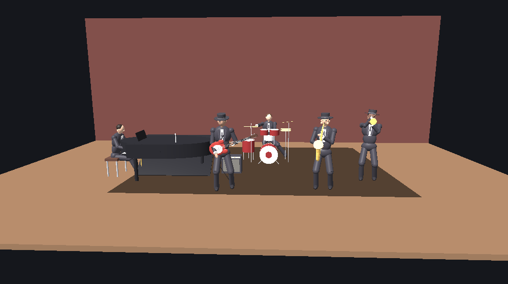

# Техническое устройство Jester Jack

Jester Jack — учебный прототип блэкджека с 3D-столом, бесконечными раундами и магазином улучшений. Сборка и запуск описаны в [README.md](../README.md).

## Стек и структура

| Часть | Технологии |
| --- | --- |
| Приложение | C++17, GLFW 3.4, Dear ImGui 1.91.9b |
| Графика | OpenGL 3.3 Core, GLSL 330, GLAD, GLM 1.0.1 |
| Сборка и тесты | CMake 3.24+, CTest, пресеты desktop/core-only |

Зависимости включены в `third_party/`; CMake не скачивает библиотеки. Имя собираемого executable и target — `blackjack_forge`.

| Файлы | Назначение |
| --- | --- |
| `src/game/` | Правила, колода, исходы, награды, состояние забега и магазин; без графики, файлов и часов |
| `src/presentation/` | Очередь показа карт, раскрытия дилера и начисления награды; без команд игры и случайных чисел |
| `src/graphics/BandModel.*`, `src/presentation/BandSync.*` | Джазовый ансамбль на сцене и привязка к долям саундтрека (подробно ниже) |
| `src/audio/` | Звук: `Mixer` решает, что и когда играет (без ОС и устройств), `Engine` играет в отдельном потоке; без правил и графики |
| `src/graphics/` | Меши, текстуры, шейдеры, камера, свет и GPU-ресурсы; без расчёта исходов |
| `src/graphics/RendererRoom.inl` | Театральные арки, портьеры, колонны и освещение зала |
| `src/main.cpp` | Окно, ввод, меню, UI, время перехода и преобразование Snapshot в Scene |
| `assets/` | Шейдеры, иллюстрации TGA, шрифты и их лицензии |
| `assets/audio/` | Эффекты (`sfx/`), звуки интерфейса (`ui/`), главная тема и саундтреки (`music/`); описание в `assets/audio/README.md` |
| `tests/game_tests.cpp` | Проверки правил, всех улучшений, начальных колод, возрождения, магазина и воспроизводимости |
| `tests/presentation_tests.cpp` | Проверки порядка показа, ускорения, активных способностей и независимости от шага времени |
| `tests/band_tests.cpp` | Проверки ансамбля и разбора файлов синхронизации |
| `tests/audio_tests.cpp` | Проверки перемешивания саундтреков, зацикливания главной темы, перекрытия эффектов, приглушения и отсутствующих файлов (на фиктивном бэкенде, без звуковой карты) |
| `src/presentation/EntranceTransition.hpp` / `tests/entrance_tests.cpp` | Независимые от частоты кадров этапы входа, пропуск, короткое затемнение и повторный запуск |
| `scripts/balance_sim.cpp` | Воспроизводимое сравнение прогрессии без знания закрытых карт |

## Правила и состояние

Раздача — одна рука против дилера; раунд — пять раздач на общую цель, либо шесть с LAST LAUGH. Цели: 30, 38, 46, 54, 62, 70, 78, затем всегда 86. После выполнения цели продолжение ведёт в магазин. Последняя раздача без достижения цели автоматически переводит игру в `RunLost`; выполненная цель имеет приоритет. Следующий раунд получает полный запас раздач и нулевой счёт раунда, сохраняя монеты и улучшения. Неиспользованные раздачи не переносятся. Ставок и финальной победы нет.

Дилер останавливается на 17, включая мягкие 17. Туз стоит 1 или 11. Натуральный блэкджек — 21 на первых двух картах, сильнее обычной суммы 21. За победу начисляются сумма руки и 4 монеты плюс эффекты улучшений; натуральный блэкджек без улучшений приносит 21 очко. Ничья даёт ноль и сохраняет серию, проигрыш руки даёт ноль и обрывает серию. Обе расходуют раздачу, но сами по себе не завершают забег.

`Game` принимает команды `deal/hit/stand/advance/buy/sell/replace/activate/chooseCard/leaveShop/revive` и предоставляет `Snapshot`. Недопустимая игровая команда возвращает `false` без изменения состояния и будущей последовательности случайных чисел. `restart(seed, deck)` начинает новый забег с выбранной колодой; `restart(seed)` сохраняет выбор колоды. Состояние содержит фазу, карты, счёт и цель раунда, оставшиеся раздачи, общие очки и победы, монеты, серию, улучшения и предложения магазина. Поля `startDeck/maxHands/revivesLeft/revivalsUsed` описывают начальную колоду и её ресурс. `owned` — единственный список экипировки с пределом `maxEquipmentSlots = 8`; отдельный декоративный инвентарь не создаётся. `usedHandAbilities/usedRoundAbilities`, `cardChoices`, `pendingRescue`, `alteredThisHand/rescuedThisHand` хранят расход зарядов, незавершённый выбор и условия совместных эффектов. `abilityStatus` сообщает оставшийся заряд, доступность и причину запрета.

Каждая раздача равномерно перемешивает новую колоду из 52 карт Fisher-Yates с rejection sampling. Отдельные `std::mt19937` карт и магазина сохраняют воспроизводимость: одинаковые seed, колода и действия дают одинаковый результат. Покупки не меняют поток карт; частота натурального блэкджека искусственно не корректируется. Приложение выбирает новый seed при обычном запуске; `--seed N` фиксирует его, `--smoke` по умолчанию использует 42.

## Начальные колоды и возрождение

После нажатия START игрок выбирает одно преимущество для забега:

| Название в меню | `StartDeck` | Эффект |
| --- | --- | --- |
| LAST LAUGH | `ExtraHand` | Шесть раздач в каждом раунде |
| ENCORE | `SecondLife` | Одно возрождение за забег, пять раздач в раунде |
| GOLDEN FOOL | `Rich` | 10 начальных монет, пять раздач в раунде |

`Standard` — внутренний вариант по умолчанию для API и запуска без выбора: пять раздач без дополнительного преимущества. В меню он не предлагается.

У ENCORE кнопка REVIVE появляется в `RunLost`, пока осталась жизнь. `revive()` повторяет тот же раунд с той же целью: обнуляет его очки и серию, восстанавливает раздачи, заряд Second Chance и заряды активных способностей. Монеты, улучшения, общие очки и число побед сохраняются. Возрождение тратится один раз, не меняет seed и не перематывает генераторы: следующие карты продолжают текущий случайный поток. Можно вместо него начать новый забег.

## Улучшения и магазин

Каталог содержит 40 улучшений: 14 Common, 15 Rare и 11 Legendary. Все прибавки очков, множителя и монет действуют только при победе; защита Second Chance и четыре активные способности работают до определения исхода.

Итог очков — `lround((base + bonus) * multiplier)`, где `base` равен сумме выигравшей руки, `bonus` — сумма плоских прибавок, а `multiplier = 1 + сумма прибавок к множителю`. Например, +0,5 и +1,0 вместе дают x2,5. Монеты не умножаются.

Полный [каталог 40 улучшений](catalog-balance.md) содержит цены, условия и ограничения. Активные Rewind и Redraw изменяют только последнюю добранную карту, Forked Path предлагает выбрать одну из двух карт, Lifeline сбрасывает карту перебора. Первые три имеют один заряд на раздачу, Lifeline — один на раунд. Перебор ожидает решения только при наличии применимого спасения; до решения дилер скрыт, награда не начислена. STAND принимает поражение, а завершённую раздачу открыть повторно нельзя. Alchemist усиливает победу после активной способности, Phoenix — после реального спасения от перебора в той же раздаче.

Second Chance отменяет карту до определения поражения, после чего игрок продолжает ход. Отменённая карта не возвращается в колоду. Заряд обновляется между раундами и при возрождении; продажа и повторная покупка его не восстанавливают. Прибавка к множителю действует только на спасённую руку, если она завершилась победой. Улучшение Encore и начальная колода ENCORE имеют разные эффекты.

Магазин предлагает два разных неустановленных улучшения на весь визит. Для каждого слота сначала выбирается доступная редкость по весам Common/Rare/Legendary 50/36/14, затем равномерно предмет внутри неё. Пустые редкости исключаются с пересчётом весов, уже выбранный предмет исключается из второго слота. В выбранной редкости предпочтение отдаётся предложениям, которых не было в прошлом визите; если таких нет, допускается повтор той же редкости. Это сохраняет доступные редкости, поэтому веса не являются фиксированным шансом отдельного предмета.

Можно держать до восьми улучшений без дубликатов, покупать одно, оба или ни одного предложения. Цены по редкостям — 3/6/10 монет; продажа возвращает половину с округлением вниз, то есть 1/3/5. Проданное может появиться позже. Покупки и продажи не обновляют текущую пару, повторная покупка одного предмета в том же визите запрещена. `replace(equipped, offered)` сначала проверяет все условия и сумму с учётом возврата за старое улучшение, затем заменяет один слот без промежуточной продажи. Неуспешная замена ничего не меняет. Сохранения забегов не реализованы.

`ScoreBreakdown` хранит базу, суммарный бонус, общий множитель, итог очков, заработанные монеты и `appliedEffects`. Каждая запись `AppliedEffect` содержит `relic`, `points`, `coins`, `multiplierBonus` реально сработавшего улучшения. Расчёт и запись вклада выполняются вместе; UI использует готовые данные. Порядок эффектов соответствует каталогу, при поражении или ничьей список пуст.

## Последовательность показа

`Game` разрешает команду сразу, а `presentation::Presentation` хранит промежуточный вид снимка и очередь визуальных шагов. Карты появляются по одной, дилер раскрывает закрытую карту и добирает свои карты; затем победная награда показывает базу, каждый сработавший эффект и итог. Пока очередь занята, новые игровые команды блокируются. Клик или Space завершает текущий шаг; скорость задаётся в OPTIONS. Показ не меняет правила или генераторы случайных чисел. `Action::Ability` показывает удаление, замену или добавление карты, сразу синхронизируя метаданные заряда и выбора; закрытая карта дилера остаётся скрытой до реального исхода.

При обычной скорости карта занимает 0,55 с, переворот и база награды — 0,4 с, спасение и отдельный эффект — 0,5 с, итог — 0,6 с. Ползунок сокращает каждый шаг вплоть до 0,07 с. Очередь потребляет прошедшее время между шагами, сохраняя результат при разной частоте кадров. Легендарное приобретение, спасение и легендарный эффект дают отдельную подсветку; начисленные очки остаются видны после анимации.

## Звук

Звук не влияет на правила и исходы. `Presentation` лишь помечает моменты показа событиями `Cue` (ставка, карта при раздаче, карта игрока, карта дилера, выигрыш руки, выполнение цели раунда, монеты, проигрыш руки, конец забега) в тот же миг, когда начинается соответствующий визуальный шаг; `main.cpp` забирает их через `takeCues()` и играет нужный эффект. Поэтому звук совпадает с анимацией, ускоряется вместе с ней и не повторяется при пропуске шага.

`audio::Engine` запускает собственный поток и принимает команды из очереди; открытие MP3 и ожидание устройства не задерживают кадр. На Windows MP3 воспроизводит встроенный декодер MCI (`winmm`), дополнительных библиотек нет; на других системах и в скрытых запусках (`--hidden`, `--smoke`, снимки) `Engine` ничего не воспроизводит. `audio::Mixer` не зависит от ОС: он держит по два голоса на эффект (быстрые повторы перекрываются), следит за окончанием дорожки и сам включает следующую. Саундтреки из `music/soundtrack_*.mp3` идут в случайном порядке по кругу: каждый цикл проигрывает все дорожки по одному разу и не повторяет дорожку подряд. Главная тема повторяется во всех экранах меню; при нажатии TAKE A SEAT она сменяется саундтреками, а при возврате в меню начинается заново. Во время экрана проигрыша музыка приглушается.

| Событие | Звук |
| --- | --- |
| Раздача (DEAL HAND) | `sfx/chips_bet.mp3` один раз; затем `sfx/card_deal.mp3` («Dealer's distribution of cards») для каждой из четырёх карт игроку и дилеру |
| HIT, Redraw, выбор карты Forked Path | `sfx/card_roll.mp3` («The player's card roll») |
| Дилер добирает карту | тот же `sfx/card_roll.mp3` |
| Победа в раздаче | `sfx/tada_minor.mp3`, затем `sfx/chips_win.mp3` на итоге награды |
| Победа, выполнившая цель раунда | `sfx/tada_major.mp3` вместо minor, затем `sfx/chips_win.mp3` |
| Проигрыш раздачи | `sfx/chips_win.mp3`: дилер забирает ставку |
| Конец забега | `sfx/you_lose.mp3` |
| Начало нового забега | `sfx/chips_start.mp3` |
| Покупка / обмен улучшения | `sfx/chips_bet.mp3`; продажа: `sfx/chips_win.mp3` |
| Нажатие кнопки, флажка, ячейки коллекции, F1 (открыть) | `ui/ui_open.mp3` |
| BACK, DONE, GOT IT, MENU, Escape, F1 (закрыть) | `ui/ui_close.mp3` |
| Курсор входит на кнопку (только в меню, не во время забега) | `ui/ui_selection.mp3` |
| Машина проезжает по улице в главном меню | `ambient/car_pass.mp3`, см. ниже |
| Отклонённая команда, нажатие на недоступное предложение | `ui/ui_error.mp3` |

Ставок в игре нет, поэтому «ставкой» считается раздача: именно она расходует одну из раздач раунда.

### Машина в главном меню

Седан в меню проезжает улицу каждые 32 с (`Renderer::drawMenuSedan`: движение зависит только от времени сцены). Запись `ambient/car_pass.mp3` (проезд слева направо с пиком громкости около 5,1 с и сменой стереопанорамы) запускается в начале каждого цикла и стартует с позиции `фаза + 0,45 с`, поэтому момент «машина напротив камеры» совпадает с самым громким моментом и переходом панорамы через центр. Если меню открывается посреди цикла, запись начинается с соответствующей позиции. При TAKE A SEAT или выключенном Ambient motion (машина не рисуется) звук плавно затухает за 1,2 с. Запись нормализована (+6 дБ с лимитером), оригинал не менялся.

## Джазовый ансамбль

Пять музыкантов (пианист, электрогитарист, барабанщик, трубач, саксофонист) стоят на сцене за дилером и играют саундтрек, который звучит сейчас. Все они в чёрных костюмах и белых рубашках; шляпы у гитариста, трубача и саксофониста.

| Файл | Роль |
| --- | --- |
| `src/graphics/BandModel.{hpp,cpp}` | Геометрия и позы: плоский список примитивов (куб, сфера, цилиндр) с матрицей и материалом. Без OpenGL, поэтому детерминированный и проверяемый |
| `src/presentation/BandSync.{hpp,cpp}` | Сетка долей и кривые громкости саундтрека, читаются из `assets/audio/music/soundtrack_N.sync` |
| `scripts/analyze_soundtrack.py` | Создаёт `.sync`: отслеживание долей (динамическое программирование, Эллис, 2007), сильная доля такта, энергия низких, средних, высоких частот и атак 4 раза в секунду |
| `scripts/band_preview.cpp` | Программный растеризатор для просмотра поз без GPU (инструмент разработчика) |
| `tests/band_tests.cpp` | Конечные матрицы, границы сцены, детерминизм, плавность между кадрами (нет скачков), реакция на громкость, разбор `.sync` |

*Предпросмотр, полученный `scripts/band_preview.cpp` (программный растеризатор без освещения игры).*

Модель идёт в метрах (человек около 1,8 м) и ставится на пол сцены с масштабом 1,7, чтобы пятеро читались с камеры стола и не заходили за кулисы.

Как музыканты играют:
- **Время.** `Engine::musicClock()` отдаёт номер дорожки и позицию (из MCI `status position`, с экстраполяцией между замерами); `SoundtrackSync::beatAt()` переводит её в непрерывный счёт долей. Каждое движение привязано к этому счёту: свинговые восьмые (вторая восьмая на 2/3 доли), удары по долям такта, смена аккорда раз в два такта. Если темп выше 140 BPM, играют через долю.
- **Динамика.** Усилие каждого музыканта берётся из кривых громкости: барабанщик следует атакам и низким, трубач и саксофонист высоким и средним, пианист и гитарист средним. В паузах и между номерами они играют тише и расслабляются; труба опускается.
- **Анатомия.** Руки и ноги решаются двухзвенным IK (плечо, локоть, кисть). Пианист: 52 белые и 36 чёрных клавиш, нажимаемые под пальцами правой (мелодия) и левой (аккорды) руки, педаль. Гитарист: ремень, гриф с ладами и струнами, левая рука скользит по грифу между аккордами, правая бьёт по струнам, нога отбивает долю. Барабанщик: райд со свинговым рисунком, малый, хай-хэт с педалью, том-томы, бас-бочка с биттером, филлы раз в четыре такта, палочки идут по дуге к тарелкам и барабанам. Трубач: три вентиля нажимаются по аппликатуре, раструб поднимается с фразой, щёки надуваются. Саксофонист: ремень, клавиши, раскачивание в такт, раструб поднимается на длинных фразах.
- **Без звука** (скрытые запуски, нет файлов) ансамбль играет демонстрационный грув 110 BPM, чтобы сцена не замирала.

Ограничения: это стилизованные манекены из примитивов (как и остальная сцена), а не снятая по записи партия. Ансамбль знает темп, долю и громкость трека, но не отдельные ноты, поэтому пальцы играют правдоподобные, а не воспроизводящие запись фигуры. Со стандартной камеры сцена далека, музыканты занимают около 45 пикселей по высоте.

## Рендеринг и интерфейс

Приложение преобразует видимый снимок Presentation и прогресс анимаций в Scene. `Scene::tableViewport` содержит нормированные left/top/width/height от верхнего левого угла framebuffer. Перспектива рассчитывается по области стола, затем смещается и масштабируется в полном кадре: положение карт сохраняется, а зал продолжается за прозрачным интерфейсом. Слабый верхний и нижний градиент рисуется поверх сцены, под игровыми надписями и кнопками. Меню использует обычную перспективу полного кадра. Vertex shader вычисляет `projection * view * model * position`, нормали преобразуются `transpose(inverse(mat3(model)))`. Fragment shader сочетает UV-выборку текстуры с ambient/diffuse/specular Blinn-Phong; depth test определяет видимость поверхностей.

Казино, стол и лицевые стороны карт создаются процедурно. Маска, одежда, перчатки и складки штор используют непрерывные поверхности с нормалями; статические меши загружаются при создании рендерера. Ведущий носит фиолетово-бордовый камзол с приглушённой золотой отделкой, кружевом и фарфоровой маской. Его рукава обновляют вершины и нормали в выделенном буфере; остальные части и полёт карт меняются model-матрицами. Короткие реакции на карту, победу и перебор связаны с видимым состоянием раздачи. Шахматный рисунок пола вычисляется в шейдере на одной поверхности вместо отдельных плиток.

Центральная арка обрамляет дилера, а следующие порталы уходят в глубину. Парные бордовые и фиолетовые портьеры, карнизы, отдельные колонны и тёплые свечи образуют симметричную театральную композицию без стен и потолка. Плиточный пол растворяется в естественной чёрной темноте вдали. Одна подвесная лампа освещает стол и увеличенного дилера; её трос продолжается до верхнего крепления за пределами разрешённых ракурсов. Частицы пыли распределены в мировом объёме по трём независимым координатам, медленно дрейфуют, учитывают локальное освещение и сортируются по расстоянию для прозрачности. Центральная опора увеличенного стола сохраняется. Ambient motion останавливает декоративные циклы. Дополнительных столов, фоновых персонажей и предметов на полу нет.

`ArtTexture` загружает несжатые TGA 24/32 bit, учитывая порядок BGR(A) и ориентацию изображения. UI использует атлас 24 исходных иллюстраций улучшений, процедурные символы для 16 новых предметов и три отдельные рубашки колод; рендерер использует те же рубашки для стопки и закрытых карт. Загрузчик сохраняет состояние распаковки OpenGL; для 3D-плоскостей рубашка переворачивается по вертикали. GPU-ресурсы принадлежат RAII-объектам и уничтожаются при живом контексте. ImGui рисуется поверх 3D-сцены. Папка assets копируется рядом с executable; `--assets DIR` позволяет задать другой корень ресурсов.

В меню увеличенный заголовок с шутским орнаментом и кнопки START/OPTIONS/COLLECTION/EXIT расположены слева, дворец-казино — справа в приглушённом вечернем свете. По дороге периодически проезжает тёмный седан с фарами; его движение задаётся временем сцены и не использует игровую случайность. START открывает карусель трёх колод с рубашкой и описанием преимущества; выбор работает стрелками на экране и клавишами влево/вправо. После TAKE A SEAT кнопки плавно исчезают, камера приближается к двери и замедляется; двери открываются во время замедления, затем короткое движение внутрь завершается затемнением. Полный переход длится 4,6 секунды, смена сцены происходит один раз в полностью чёрном кадре. Повторный старт во время перехода отклоняется; возврат в меню сбрасывает переход. Escape пропускает вход, отключённый Cinematic entrance оставляет затемнение длительностью 0,6 секунды без движения камеры. COLLECTION показывает все 40 улучшений с фильтрами редкости и отдельной областью описания выбранного предмета.

В игре цель и счётчики слева, увеличенные стол и дилер-шут — в центре справа. Физические фишки на столе соответствуют `owned`: от нуля в начале забега до восьми, без декоративных копий. Наведение показывает имя, редкость и эффект; клик по фишке или клавиши 1–8 выбирают улучшение для подробного просмотра. Сам просмотр не расходует заряд. Только отдельная клавиша A или кнопка ACTIVATE применяет выбранную доступную способность; рядом показаны заряд и причина недоступности. Покупка, продажа, замена и перезапуск сразу синхронизируют физические фишки с экипировкой. Во время каждого шага AppliedEffect соответствующая фишка поднимается и подсвечивается цветом редкости, под ней появляется её реальная прибавка очков, монет или множителя. HIT/STAND расположены по центру снизу; сумма руки справа снизу сохраняет красный перебор, начисленные очки показаны отдельно. Подсказка знака/дельты/масти после HIT длится около 1,5 секунды и учитывает пересчёт туза. Дилер показывает видимую сумму с `+ ?` до раскрытия. Space выполняет действие фазы или ускоряет текущую анимацию, Enter нажимает выделенную кнопку; полные правила открывает HOW TO PLAY.

GAME OVER плавно затемняет сцену и показывает белый заголовок, достигнутый раунд, итоговый счёт и три прозрачные кнопки с белыми рамками. Красное заполнение появляется только при наведении или нажатии мышью; клавиатурный фокус выделяется белой рамкой. Первая кнопка использует оставшуюся жизнь ENCORE, если она есть, иначе начинает новый забег; остальные возвращают в меню или закрывают игру.

На свободной области стола зажатая ПКМ вращает камеру, колесо меняет дистанцию, двойной клик ПКМ возвращает исходный вид. Углы и приближение ограничены; меню, магазин, Game Over и открытые панели не принимают жесты камеры. Настройки также содержат RESET VIEW.

Шрифты Cormorant Garamond и Source Sans 3 распространяются под SIL OFL 1.1. Источники и лицензии компонентов указаны в [THIRD_PARTY_NOTICES.md](../THIRD_PARTY_NOTICES.md); учебные техники сопоставлены с лекциями в [LECTURE_ALIGNMENT.md](LECTURE_ALIGNMENT.md).
