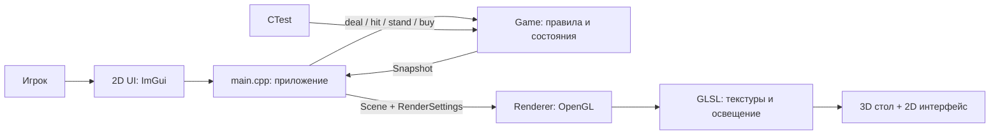
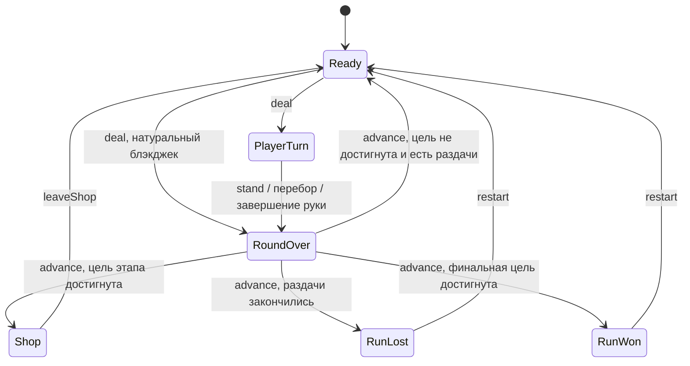

# Архитектура Blackjack Forge

Blackjack Forge — учебный прототип одиночной игры: правила блэкджека, короткий забег из трёх этапов и улучшения, которые меняют решения игрока. Вдохновение Balatro относится к циклу «игра → награда → магазин → более сложное испытание». Название, код, графика и эффекты проекта самостоятельные.

Стол, карты и фишки представлены 3D-объектами. Камера показывает стол сверху под углом, а 2D-интерфейс поверх сцены содержит счёт, правила этапа, действия и магазин. Это одна игра с 3D-сценой и 2D-интерфейсом.

## Стек и границы модулей

| Часть | Технология | Ответственность |
| --- | --- | --- |
| Приложение | C++17 | Главный цикл, время кадра, связь интерфейса и игры |
| Окно и ввод | GLFW 3.4 | Окно, OpenGL-контекст, события клавиатуры и мыши |
| Графика | OpenGL 3.3 Core, GLAD, GLM 1.0.1 | Меши, текстуры, матрицы, шейдеры |
| 2D-интерфейс | Dear ImGui 1.91.9b | HUD, кнопки, магазин, подсказки |
| Сборка | CMake 3.24+ | Воспроизводимая сборка приложения и тестов |
| Проверка правил | CTest, обычный C++ | Тесты без окна, GPU и OpenGL |

Исходники зависимостей включены в `third_party/`. После получения репозитория сборка не должна скачивать библиотеки. Компилятор C++ и CMake устанавливаются отдельно. Готовый игровой движок не используется.



Зависимости направлены от приложения к правилам и рендереру. `Game` не знает об ImGui, GLFW, OpenGL и положении карты на экране. Рендерер не рассчитывает победителя и награды. Это позволяет менять оформление и проверять правила независимо.

## Структура проекта

```text
Final-Project-CGF/
├── CMakeLists.txt              # цели приложения, правил и тестов
├── CMakePresets.json           # варианты сборки
├── .vscode/                   # настройки для продолжения в VS Code
├── src/
│   ├── main.cpp               # окно, цикл кадра, UI, команды, построение сцены
│   ├── game/
│   │   ├── Game.hpp           # Card, Snapshot, Phase, Relic, API игры
│   │   └── Game.cpp           # колода, оценка руки, дилер, забег, магазин
│   └── graphics/
│       ├── Renderer.hpp       # внешний API без деталей OpenGL
│       ├── Renderer.cpp       # Pimpl, меши, текстуры, камера, отрисовка
│       └── glad.cpp           # загрузчик функций OpenGL
├── assets/shaders/
│   ├── table.vert             # model/view/projection и нормали
│   └── table.frag             # текстуры и Blinn–Phong
├── tests/game_tests.cpp        # поведение правил и переходов
├── third_party/               # зависимости и их лицензии
└── docs/                      # архитектура, требования, план, передача проекта
```

Для этого масштаба достаточно трёх основных частей: приложение, игровая логика, графика. ECS, плагины, сеть и отдельный редактор уровней не нужны.

## Игровые данные и состояния

`Card` хранит ранг и масть. `evaluateHand()` возвращает сумму, мягкую руку, натуральный блэкджек и перебор. Туз стоит 11, пока это допустимо; затем его значение уменьшается до 1. Натуральный блэкджек — 21 на первых двух картах.

`Game` владеет колодой, генератором случайных чисел и состоянием забега. Команды раздачи, хода, покупки и перехода возвращают признак успешного действия; недопустимая команда не меняет состояние. `restart(seed)` сбрасывает забег. UI читает `Snapshot` через `state()`: руки, фазу, этап, цель, счёт, оставшиеся раздачи, монеты, улучшения и расчёт последней награды. Значение `seed` позволяет воспроизвести забег.



Начальные параметры баланса: цели 30, 65 и 100 очков, до пяти раздач на этап. Для каждой раздачи перемешивается новая колода из 52 карт; счётчик доступных раздач уменьшается при раздаче. На первых двух этапах дилер останавливается на 17, включая мягкие 17; на последнем — на 18. За победу начисляется сумма руки с бонусами, умноженная на множитель и округлённая до целого; ничья и поражение дают ноль. Натуральный блэкджек даёт бонус 10. Цель проверяется после раздачи, при переходе дальше; счёт этапа обнуляется при выходе из магазина.

| Улучшение | Начальное правило |
| --- | --- |
| Precision | Победа с 21 умножает награду на 2 |
| Long Hand | Победа с четырьмя и более картами даёт +30 к базе |
| Second Chance | Автоматически отменяет карту перебора один раз за этап |
| Streak | Добавляет 0,5 к множителю за каждую предшествующую победу подряд |

Поражение обрывает серию побед, ничья сохраняет её. Серия переносится между этапами. Если одновременно действуют Streak и Precision, сначала формируется множитель серии, затем он удваивается.

Магазин использует фиксированный каталог: цена улучшения 3 монеты, награда за этап 5 монет, повторная покупка одного улучшения запрещена. Эти числа служат проверке прототипа и требуют дальнейшего тестирования баланса.

## Путь кадра и графический конвейер

1. GLFW собирает события; ImGui строит кнопки и отправляет команды в `Game`.
2. Приложение читает актуальный `Snapshot` и собирает `Scene`: видимые карты, монеты и время; `RenderSettings` содержит настройки камеры, света, текстур и анимации.
3. Рендерер задаёт положение, поворот, масштаб и материал объектов, обновляет viewport, очищает цвет и глубину, включает depth test и рисует 3D-сцену.
4. Вершинный шейдер преобразует вершину как `projection × view × model × position`. Нормаль преобразуется матрицей `transpose(inverse(mat3(model)))`.
5. Фрагментный шейдер сочетает образец `GL_TEXTURE_2D` с ambient, diffuse и specular составляющими Blinn–Phong.
6. ImGui рисует 2D-интерфейс поверх сцены; GLFW показывает готовый кадр.

Геометрия стола, карт и фишек создаётся процедурно. Карты получают текстуры, сформированные на CPU и загруженные на GPU: это сохраняет небольшой размер проекта и позволяет показать полный путь от пикселей до текстурированного объекта. Ресурсы OpenGL освобождаются до уничтожения контекста.

## Проверка и развитие

Тесты правил должны покрывать тузы, натуральный блэкджек, перебор, поведение дилера, награды, ограничения магазина и переходы состояний. Визуальная проверка отдельно подтверждает освещение, текстуры, глубину, изменение размера окна и совпадение HUD с игрой. Прохождение тестов без GPU не подтверждает корректную отрисовку.

После устойчивого прототипа можно вынести UI и построение сцены из `main.cpp`, добавить анимацию раздачи, звук, сохранения и новые испытания. Эти возможности запланированы, но не входят в обещания стартовой версии.
