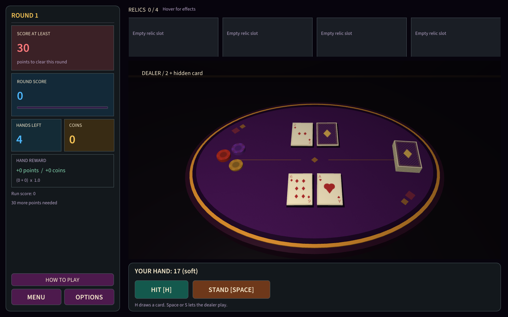

# Jester Jack — handoff for a new account

Project snapshot: **October 22, 2026**. This document transfers working context, not account history. Read it first, then the four topic files below. If documentation conflicts, actual behavior is determined by the source code; new direct instructions from the owner take precedence over earlier preferences.

## Current version

- Repository: [F1j1tun1/Final-Project-CGF](https://github.com/F1j1tun1/Final-Project-CGF).
- Handoff branch: **`codex/account-handoff`**. It contains the latest game and these documents. A regular Download ZIP or clone without a branch name will get the old `main`.
- Latest commit that changed the game: **`f7e9526d158b84d7e62e6b88ebc0934db7df65c9`** — enlarging text beside relics. Handoff commits after it change documentation only.
- Previous local development branch: `codex/theatre-polish`.
- `main` and remote `main` at the time this handoff was prepared: **`95045813dbe8579bb806739e59140dc33895aaa4`**. The owner deferred updating `main`: **do not merge branches or update `main` unless explicitly asked**.
- Verified Windows Release build `JesterJack.exe`, SHA-256: `60E799EB7461306B4804A4F951985BD247DD43753900F58845F48FB1287E2A46`.

```powershell
git clone --branch codex/account-handoff https://github.com/F1j1tun1/Final-Project-CGF.git JesterJackWork
cd JesterJackWork
git status --short
git log -1 --oneline
```

The full ZIP contains source files, the built game, a Git bundle, and lecture materials. The small context ZIP contains documents and current illustrations; it does not replace the source. Paths on the previous laptop are listed in a separate **LOCAL_SETUP.md**, which is intentionally not published to GitHub.

## What to read

1. [GAMEPLAY_AND_UI.md](GAMEPLAY_AND_UI.md) — rules, all 24 relics, economy, decks, controls, current visuals, and rejected alternatives.
2. [ENGINEERING.md](ENGINEERING.md) — C++/OpenGL structure, cards, animation queue, UI, meshes, lighting, camera, assets, and edit points.
3. [WORKFLOW_AND_CHECKS.md](WORKFLOW_AND_CHECKS.md) — build, checks, screenshots, delivery of the game with sources, and multi-contributor workflow.
4. [ASSISTANT_GUIDE.md](ASSISTANT_GUIDE.md) — how to continue working with the owner, what transfers between accounts, and which tools and skills may be useful.
5. Existing technical documents: [architecture](../ARCHITECTURE.md), [lecture alignment](../LECTURE_ALIGNMENT.md), [course requirements](../COURSE_REQUIREMENTS.md), [launch and controls](../../README.md), [sources and licenses](../../THIRD_PARTY_NOTICES.md).

## Current result

An educational single-player game, Jester Jack: C++17, OpenGL 3.3 Core, GLFW, GLM, Dear ImGui. It is blackjack with multiple hands per round, a point target, coins, and relics. Rounds are endless; there are no bets. Card randomness is not manipulated. Rules from early messages were clarified several times; use only the current catalog and current logic.

Visuals: a mysterious theater without horror, green table, one dealer in a porcelain mask, symmetrical purple-burgundy curtains, arches, two tall lamps, candles, and a tiled floor. No extra tables, background characters, or scattered objects. The menu shows an evening casino and a dark sedan with headlights passing periodically. Camera controls use the right mouse button and scroll wheel.

Last completed change: names and descriptions to the right of four chips were enlarged; names use 22–28 px and descriptions 18–22 px depending on window width. Chip size stayed the same, and descriptions wrap at word boundaries without splitting numbers such as `+0.6`. All 24 descriptions and the full relic row were checked. The build and source were updated on the desktop. **There is no unfinished game change**; the current task is only to transfer context.



## What does not transfer automatically

Chat history, account memory, GitHub connection, authentication, installed plugins, and live agents do not become part of a new account. Old tokens or a copy of the entire Codex profile folder are not needed. The new account reads these documents and opens the source; reconnect GitHub if needed. If only a regular web chat is available without local tools, it cannot build and run the Windows/OpenGL game itself.

The previous working directory is a **linked Git worktree**: its `.git` file points to another directory. Do not transfer that file by itself as a repository. Use a fresh clone or `repository.bundle` from the full package. Do not copy old `build/` or `CMakeCache.txt` to another computer: they contain absolute paths and compiler-specific configuration.

## Future work

- Update `main` only on a separate request from the owner.
- Custom music and sounds were discussed as future work; the audio system and custom audio files are currently absent.
- There is no save system between launches, persistent settings file, or continue menu.
- README/HOW TO PLAY contain a few older descriptions of controls/hover; exact discrepancies are listed in GAMEPLAY_AND_UI.md. These are known minor text issues, not a reason to change the rules during handoff.
- Ready-to-use in-game TGA illustrations exist, but separate source PNGs/layers and their creation history were not found in the current repository. Do not assume they are available.
- Report/slide and demonstration requirements are described in COURSE_REQUIREMENTS.md; do not treat defense materials as complete without checking whether they exist.

## First request to the new assistant

Copy this text, attach the small context ZIP, and open the source folder:

> We are continuing Jester Jack. Read docs/handoff/START_HERE.md, then GAMEPLAY_AND_UI.md, ENGINEERING.md, WORKFLOW_AND_CHECKS.md, and ASSISTANT_GUIDE.md. The current code is on codex/account-handoff and is based on f7e9526; do not update main yet. First check the actual folder, branch, and local changes. Do not redesign the game based on old rejected ideas. Briefly confirm that you understand the state, then wait for my next task. If we are using the same laptop, consult LOCAL_SETUP.md from the ZIP. Communicate briefly in Russian; keep the game UI in English.
